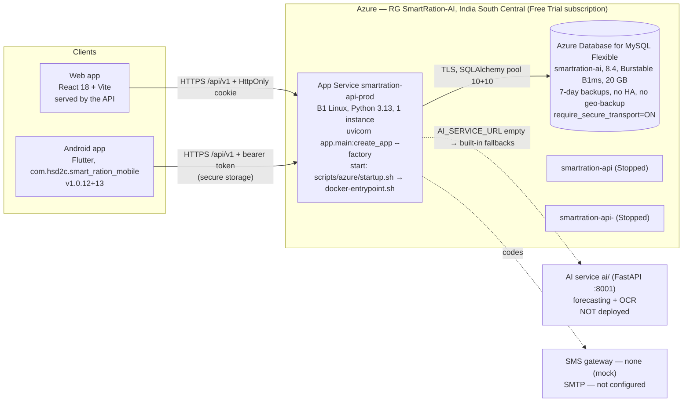

# Current architecture (as found, 2026-10-17)

The system as it runs today, with the evidence used. The design rationale lives in the existing documents:
[SYSTEM_ARCHITECTURE.md](SYSTEM_ARCHITECTURE.md), [BACKEND_ARCHITECTURE.md](BACKEND_ARCHITECTURE.md),
[PYTHON_ARCHITECTURE.md](PYTHON_ARCHITECTURE.md), [AI_ARCHITECTURE.md](AI_ARCHITECTURE.md),
[DATA_ARCHITECTURE.md](DATA_ARCHITECTURE.md). This page only records what was observed.

## Deployed system

Evidence: `az resource list`, `az webapp config show`, `az mysql flexible-server show` (read-only, 2026-10-17);
start-up log line `startup: commit 8d7f2a5` (2026-10-13 00:53 UTC); `GET /health`, `/api/health`, `/ready` → 200.

## Repository map (tracked + notable untracked; generated folders excluded)

| Path | Role | Notes |
|---|---|---|
| `backend/SmartRation/app/` | **The API.** FastAPI factory `app.main:create_app`; `api/routes` (12 routers), `services` (domain logic), `models` (SQLAlchemy), `schemas` (Pydantic), `security`, `middleware`, `config/settings.py` | 101 paths / 108 operations in the committed OpenAPI contract |
| `backend/SmartRation/migrations/` | Alembic, 7 revisions (`0001_initial_schema` … `0007_user_totp`) | applied at start-up when `RUN_DB_SETUP=true` |
| `backend/SmartRation/scripts/` | setup/seed/verify/reset DB, OpenAPI export, integrity checks, load test | |
| `backend/SmartRation/tests/` | unit, api, integration incl. `mysql_suite` (9 files: CRUD, security, performance, concurrency, integrity, scale, least privilege) | |
| `ai/` | Separate FastAPI AI service: forecasting models, OCR, training/evaluation, own tests | not deployed |
| `frontend/` | React 18 + Vite 6, axios, zustand, zod, react-router, leaflet; 40 pages | built into the API package (`frontend-dist`) |
| `smart_ration_mobile/` | Flutter app (Riverpod, go_router, dio, secure storage, mobile_scanner); 76 Dart files in `lib`, 31 test files | API URL only via `--dart-define=API_BASE_URL`; release refuses non-https and `APP_ENV=development` |
| `database/` | schema SQL, `queries/NN_*.sql` integrity checks, synthetic seeds, local backups (git-ignored) | |
| `tests/` | `regression`, `integration/mysql` (direct pymysql), `e2e` (Playwright, own npm project), `smoke`, `load`, `live` | |
| `scripts/` | `azure/` (build_package, deploy, set-email, set-runtime-db-account), `database/` (backup, restore, restore drill), `development/`, `testing/run-tests.ps1` | |
| `.github/workflows/` | `ci.yml` (python, ai, csharp, frontend, android, security, code-scan, docker), `uptime.yml`, `playwright.yml`, `azure-deploy.yml` | CI runs on PRs/main only; `azure-deploy.yml` is inert (SEC-08) |
| `backend/SmartRation.Api*`, `SmartRation.sln` | Legacy C# API (243 files) | superseded; still built by CI |
| `mobile/` | Expo template | unused |
| `deployment/`, `render.yaml` | docker/nginx/staging/production configs; Render blueprint | Render unused |

## Request path (representative: citizen books, shop collects)

1. Client → `POST /api/v1/bookings` → `booking_service.book`: locks the `TimeSlot` row (`SELECT … FOR UPDATE`),
   checks date ≥ today (UTC date only), capacity, one active booking per slot, remaining monthly entitlement → creates
   `Token` + `TokenItems`, increments `BookedCount`, audit row, notification. One transaction.
2. Client → QR payload (HMAC with `QR_SECRET`) → shop scans → `/api/v1/qr/scan` verifies signature, shop scope.
3. Shop → collect with `Idempotency-Key` → `collection_service`: replay check by key, lock token, lock that shop's
   inventory rows, refuse if any item short, write `RationCollection` (unique `TokenId`, unique `IdempotencyKey`),
   ledger movements, mark token completed, audit. Unique-key conflict = "someone else completed it", nothing saved.

## Cross-cutting

| Concern | Implementation (inspected) |
|---|---|
| AuthN | Argon2id passwords; JWT access + rotating refresh (row lock, reuse revokes family); web refresh in `HttpOnly; SameSite=Strict` cookie; optional TOTP for staff; lockout 5/15 min |
| AuthZ | Role + ownership checks in services; deny-by-default route test (`tests/unit/test_route_access.py`); shop scope (N2) |
| Rate limiting | In-process limiter keyed by client IP from `TRUSTED_PROXY_HOPS` (live: 1). Single instance, so the in-memory store is consistent; it would not be with >1 instance |
| Config | `pydantic-settings`; start-up refuses leaked secrets, demo OTP, mock SMS with real data, unknown `ENVIRONMENT` |
| Logging | Structured JSON, request id, security events; no bodies/query strings. Goes to App Service container log only (no Application Insights) |
| Errors | Uniform `{errorCode, message}` envelope; clients translate by `errorCode` |
| Time | Naive UTC everywhere (`app/utils/time.py`); no business timezone (affects booking "today" and month boundaries) |
